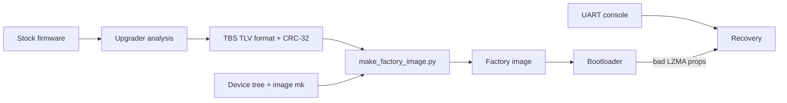

<div align="center">

# DIR-825 G1 OpenWrt Port

**Bringing OpenWrt to a router that OpenWrt does not support.**

  

[](https://github.com/adineo-cmd/dir825g1-openwrt/stargazers) [](https://github.com/adineo-cmd/dir825g1-openwrt/commits)

[Quick start](#quick-start) · [How it works](#how-it-works) · [Features](#features)

</div>

---

The **D-Link DIR-825 G1** (Realtek RTL8197DN, 8 MB SPI NOR, 64 MB RAM) has no
official OpenWrt target and no community firmware. This repository contains the
device port, the reverse-engineered stock image format, the flashing and recovery
tooling, and an honest log of everything that went wrong.

**Including the mistake that bricked the test unit.** Every warning below was
learned first-hand; read them before flashing anything.

## Features

| | Feature | What it does |
| --- | --- | --- |
| 🧩 | **Device port** | Device tree, image definition and first-boot script for the RTL8197D subtarget. |
| 🔬 | **TBS image format** | The stock TLV container and its custom CRC-32, recovered from the upgrader binary and verified against real images. |
| 🛠️ | **Tooling** | Factory image builder with LZMA repacking, raw flash writer, TFTP server and a stock-firmware shell. |
| 📓 | **Engineering log** | Thirteen numbered warnings learned the hard way, each with the failure it prevents. |

## How it works

The port follows the hardware, not the marketing name:

1. Identify the exact board revision and its flash layout.
2. Dump `mtd0` and disassemble the bootloader to learn what it will accept.
3. Recover the stock container and checksum from the vendor upgrader.
4. Build a factory image, repack the kernel with the LZMA properties the
   bootloader demands, and flash it.
5. Log every failure so the next person does not repeat it.



## Quick start

Python 3.10+. Building the firmware needs a Linux host with the OpenWrt build dependencies; recovery needs a USB-TTL adapter.

**Build an image**

```bash
python3 tools/make_factory_image.py --help
python3 tools/make_factory_image.py --fix-lzma
```

**Recovery**

```bash
python3 tools/tftp_server.py --help
python3 tools/flash_raw.py --help
```

## Project structure

```text
openwrt-device/    DTS, image definition, first-boot script
patches/            build fixes for a modern host
tools/              image builder, flash writer, TFTP server, RE shell
docs/               full reverse-engineering write-up
```

## Read these before flashing

1. **Never flash a B1/C1 image on a G1.** They are completely different boards; it
   is a guaranteed hard brick. G1 = RTL8197DN @660 MHz, 8 MB NOR, 64 MB RAM.
2. **The bootloader only accepts LZMA properties byte `0x5d`** (lc=3, lp=0, pb=2,
   8 MB dict). OpenWrt's default pipeline emits `0x6d`, which the bootloader
   silently fails to decompress — it boot-loops. Repack with `--fix-lzma`. This is
   the exact mistake that bricked the test unit.
3. **Any reboot while `/var/update_img` exists flashes `/var/image.img`.** The
   stock kernel's `machine_restart` handler checks the flag on *every* reboot, not
   just upgrade-initiated ones.
4. **There is no network recovery.** The bootloader contains no IP, TFTP or HTTP
   stack (verified from a full `mtd0` dump). The usual D-Link "hold reset →
   192.168.0.1" page does not exist on this model. UART is the only rescue.
5. **Never erase or overwrite `mtd0`/`mtd3`.** Their config sectors hold the MAC
   address, serial number and Wi-Fi calibration tables. Device dumps are kept out
   of this repository for that reason.
6. **Userspace cannot write the flash.** `> /dev/mtdN` and `> /dev/mtdblockN` both
   fail against the custom Realtek mtd layer; only the kernel
   `flash_update_img` path writes.
7. **Stock firmware 7.00 `webupg` dies on long command output.** Background long
   jobs and poll a flag file; pipe binary data through `openssl base64`. The module
   also jams after a standalone `/usr/bin/upgrader` run and only a reboot clears it.
8. **The official 7.12B01 hotfix is SHRS-encrypted** and useless as a format
   template. The 7.00-era upgrader also wants the product string
   `RTL8197DN_AC1200`, so anything else is rejected with a generic error.
9. **A sandboxed TFTP server never receives LAN UDP.** Run the transfer server
   unsandboxed.
10. **`/usr/bin/upgrader` exits 42 standalone** — it needs the message-bus daemon
    context. Use the reboot-flag path or the web UI.
11. **Stock firmware 7.xx has an unpatched auth-bypass and RCE** (D-Link advisory
    SAP10294, EOL). Never expose a G1's web UI to the internet. This project's
    tooling uses that RCE on its own router, for research only.
12. **`tbs_dlink` is missing from the base repository**, which breaks the DIR-815
    D1 build. The TBS header is now generated by `tools/make_factory_image.py`.
13. **Building the 2019-era tree on a modern host needs two fixes**: the m4 1.4.18
    SIGSTKSZ patch in `patches/`, and gcc-13 / Python 3.12 regex updates in
    `include/prereq-build.mk`.

`docs/REVERSE-ENGINEERING.md` walks the full flash path, including the exact
`flash_update_img` behaviour and the bootloader disassembly.

## Status

The port builds clean and the image format is fully verified. Ethernet is built
but not yet booted; Wi-Fi is experimental. The test unit needs serial recovery
once a USB-TTL adapter is available.
